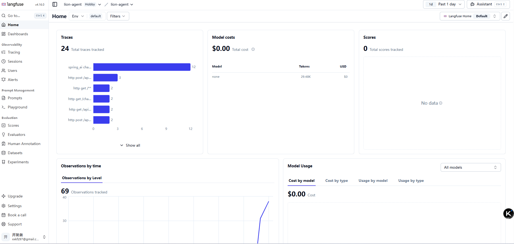
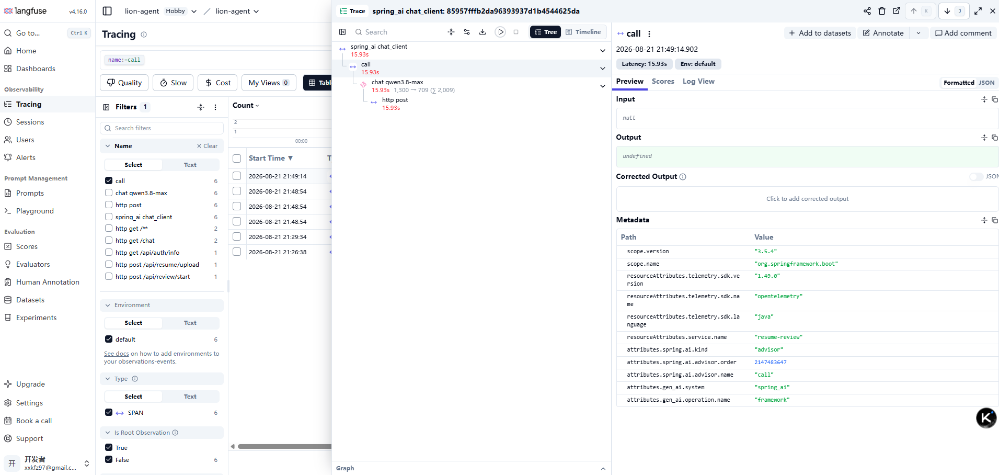
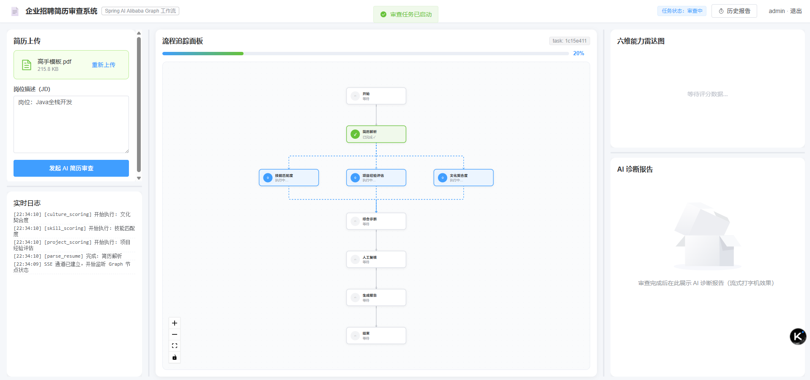
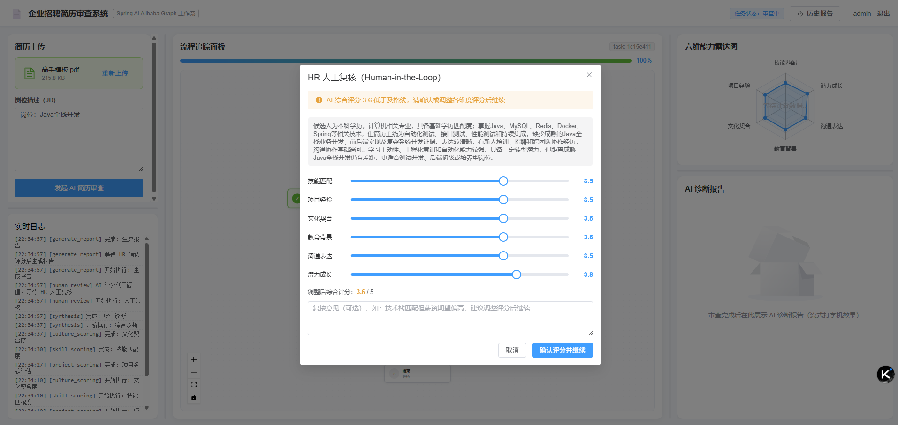
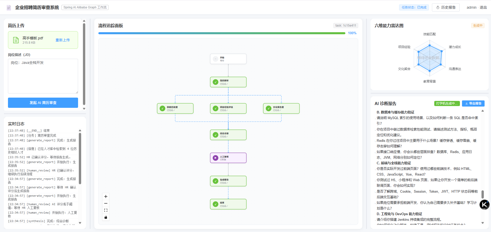

<div align="center">

<h1>🦁 Lion Resume Review · AI 招聘审查智能体</h1>

<p><strong>基于 Spring AI Alibaba Graph 的企业级招聘审查智能体 —— 多智能体工作流 · 并行评分 · 人机协同断点续跑 · LLM 全链路可观测</strong></p>

<p>
  
  
  
  
  
  
  
  
  
  
  
</p>

<p>
  <a href="#项目亮点">项目亮点</a> ·
  <a href="#graph-实战">Graph 实战</a> ·
  <a href="#快速启动">快速启动</a> ·
  <a href="#环境变量配置">环境变量</a> ·
  <a href="#常见问题">常见问题</a>
</p>

</div>

---

以 **Spring AI Alibaba Graph（状态机工作流）** 为核心编排引擎的 AI 招聘审查系统：7 个节点组成「简历解析 → 技能 / 项目 / 文化三维并行评分 → 综合诊断 → 人工复核 → 报告生成」的有向图，其中人工复核节点采用**官方 Human-in-the-Loop 中断机制**（`InterruptableAction` + `Checkpoint` + `updateState` + `resume`），Graph 真正挂起并把状态落盘，HR 确认后从**中断处继续跑后续节点**，而不是重新调用一次报告生成。全流程节点状态经 Redis Pub/Sub 广播 + SSE 推送到前端，实现流程面板实时高亮、雷达图动态刷新、报告打字机流式渲染，并由 **OpenTelemetry + Langfuse** 完成 LLM 调用全链路可观测。

---

## 目录

- [项目亮点](#项目亮点)
- [技术栈](#技术栈)
- [系统架构](#系统架构)
- [Graph 实战](#graph-实战)
  - [核心概念速查](#核心概念速查)
  - [本项目的图结构](#本项目的图结构)
  - [图装配代码](#图装配代码)
  - [状态键合并策略](#状态键合并策略)
  - [并行 fan-out / fan-in](#并行-fan-out--fan-in)
  - [Human-in-the-Loop 中断与恢复](#human-in-the-loop-中断与恢复)
  - [重新复核：回溯历史 Checkpoint](#重新复核回溯历史-checkpoint)
  - [Checkpoint 存储可切换](#checkpoint-存储可切换)
  - [踩坑清单](#踩坑清单)
- [项目结构](#项目结构)
- [快速启动](#快速启动)
- [环境变量配置](#环境变量配置)
- [SSE 事件协议](#sse-事件协议)
- [核心实现机制](#核心实现机制)
- [Langfuse 可观测性](#langfuse-可观测性)
- [常见问题](#常见问题)

---

## 项目亮点

> 以下均聚焦**后端编排能力**，也是本项目作为 Spring AI Alibaba Graph 实战样本的核心价值点。

**1. 真正的 Human-in-the-Loop，不是"假挂起"**

不采用「节点返回后自己在业务代码里调报告生成」这类绕开框架的做法，而是使用官方中断机制：

`HumanReviewAction implements InterruptableAction` → `interruptAfter()` 返回 `InterruptionMetadata` → Graph 在该节点**真正停止执行**并写入 `Checkpoint`；HR 确认后由 `CompiledGraph.updateState()` 写回调整值、`RunnableConfig.resume()` 从中断处继续流向 `generate_report`。中断与恢复全部由框架驱动，**已执行的节点不会重跑**。

**2. 断点可回溯的 Checkpoint 体系**

- `threadId = taskId`，一次审查一个线程，Checkpoint 天然按任务隔离；
- 当前 `checkpoint-store: mysql`（`MysqlSaver` 落 `GRAPH_THREAD` / `GRAPH_CHECKPOINT` 两表，首次启动自动建表），可一行配置切回 `redis`（`RedisSaver`，支持 TTL）；
- 支持「**重新复核**」：即使任务已完成，也能用 `checkpointSaver.list()` 遍历历史 Checkpoint，定位 `nodeId == human_review` 的那一条，用它的 `checkPointId` 构造 `RunnableConfig` 重新续跑，而不是重跑整条流水线。

**3. 并行 fan-out / fan-in，LLM 评分耗时从 3T 降到 T**

`parse_resume` 三条出边同时触发 `skill_scoring` / `project_scoring` / `culture_scoring`，三个节点再汇聚到 `synthesis` 形成**屏障**（全部完成才进入）。三个 LLM 评分节点从串行 3 次调用变为并行，整体耗时近似单次调用。

**4. 声明式的状态合并策略（KeyStrategy）**

`GraphConfig.keyStrategyFactory` 为每个状态键声明合并规则：`warnings` 用 `AppendStrategy`（并行节点累积追加），评分 / 复核意见等单值字段用 `ReplaceStrategy`，另有自定义 `CustomStrategy` 扩展点。节点只需 `return Map` 增量，合并逻辑由框架统一处理。

**5. 多实例可横向扩展的事件层**

节点事件不是直接写 SSE，而是 `GraphEventPublisher → Redis Pub/Sub → 各实例 GraphEventSubscriber → 本机 SseEmitterManager`。浏览器连在哪个实例上都能收到自己 `taskId` 的事件，后端可无状态扩容。

**6. LLM 容错重试 + 指数退避**

`LlmService` 统一封装重试（默认 3 次、1.5s 基数、指数退避），限流 / 网络抖动时自动重试并向前端推送 `retrying` 状态，单个节点抖动不会整条流水线失败。

**7. trace 跨线程传播，LLM 链路零侵入可观测**

Graph 在 `graphExecutor` 线程池中异步执行，通过 `ContextPropagatingTaskDecorator` 自动传递 OTel context，使「HTTP 请求 → 线程池 → Graph 节点 → LLM 调用」串成一条 trace，业务代码**不需要手动创建 Span**。

**8. 异步解耦 + 幂等 CAS 状态机**

- `startReview()` 只建任务、投递线程池、立即返回 `taskId`，HTTP 不被长流程阻塞；
- 恢复链路用 MyBatis-Plus 条件更新做 CAS（`UPDATE ... WHERE status='NEEDS_REVIEW'`），影响行数非 1 即拒绝，防止 HR 重复点击导致**两次恢复、双倍 LLM 开销**。

**9. 可插拔的基础设施**

Checkpoint 存储（Redis / MySQL）、向量库（`VECTORSTORE_TYPE=none` 即完全关闭 Milvus）均通过配置开关切换，不强依赖任何中间件也能跑通审查主流程。

**10. 配置安全**

`application.yml` 中只有 `${ENV_VAR:默认值}` 占位符，无任何明文密钥；本地由根目录 `.env` 加载（`spring.config.import`），生产由容器 / K8s Secret 注入同名变量即可。

---

## 技术栈

| 层 | 技术 | 说明 |
| --- | --- | --- |
| AI 编排 | Spring AI Alibaba Graph 1.1.2.3 | StateGraph 状态机 / Checkpoint / HIL |
| 大模型 | 阿里千问 `qwen3.8-max`（DashScope） | 解析、评分、诊断、报告 |
| 后端框架 | Spring Boot 3.5.4（Java 17） | WebFlux `Flux` 流式、SSE |
| ORM | MyBatis-Plus 3.5.x | Lambda 条件构造 / 逻辑删除 / 雪花 ID |
| 数据库 | MySQL 8.x（utf8mb4） | 业务三表 + Graph Checkpoint 两表 |
| 缓存 / 状态 | Redis 7 + Redisson | SSE 事件 Pub/Sub、RedisSaver（可选） |
| 向量库 | Milvus 2.x（可选） | 历史人才向量召回 |
| 鉴权 | Sa-Token | Token 登录态 |
| 可观测性 | OpenTelemetry OTLP + Langfuse | LLM 全链路 trace |
| 前端 | Vue 3 + Vite + Element Plus + Vue Flow + ECharts | 流程面板 / 雷达图 / 流式报告 |

---

## 系统架构

```
┌──────────────────────── 前端 (Vue3, :5173) ────────────────────────┐
│  UploadPanel · FlowPanel(Vue Flow) · RadarChart(ECharts)           │
│  ReportPanel(流式+导出) · ReportHistory · ReviewModal(HR 复核)      │
└──────────────┬─────────────────────────────────────────────────────┘
               │ REST /api/**  +  SSE /api/review/stream/{taskId}
┌──────────────▼──────────── 后端 (Spring Boot, :8080) ──────────────┐
│  AuthController / ResumeController / ReviewController               │
│        │                                                            │
│  ReviewTaskService ── 创建任务 → graphExecutor 异步执行 Graph         │
│        │                                                            │
│  CompiledGraph（主图，单例）                                         │
│    parse_resume → [skill|project|culture] → synthesis               │
│                 → human_review（中断）→ generate_report              │
│        │                                                            │
│  HR 确认 → updateState + resume → 从中断处继续跑后续节点              │
│        │                                                            │
│  BaseTrackingAction（切面）→ 节点状态 → GraphEventPublisher          │
│        │                          │                                 │
│        │                    Redis Pub/Sub → SseEmitterManager       │
│        ▼                                                            │
│  ReviewReportService（落库 / 向量化）→ LlmService → Langfuse(OTLP)   │
└─────────────────────────────────────────────────────────────────────┘
```

**一次审查的数据流**

1. 上传简历 → 返回 `resumeId`；
2. `POST /api/review/start` → 建 `ReviewTask`、立即返回 `taskId`（Graph 异步执行）；
3. 前端用 `taskId` 订阅 SSE；
4. 节点执行 → 切面广播事件 → Redis Pub/Sub → SSE 推送 → 面板 / 雷达图 / 报告实时更新；
5. `human_review` 中断 → 前端弹 HR 复核框 → 确认 → `updateState + resume` → 从中断处续跑；
6. 报告落库，整条链路（HTTP → Graph → LLM）由 OTel 追踪到 Langfuse。

---

## Graph 实战

> 这是本项目最核心的部分：Spring AI Alibaba Graph 的知识点与在项目中的落地方式。

### 核心概念速查

| 概念 | 作用 | 本项目中的用法 |
| --- | --- | --- |
| `StateGraph` | 定义节点与边的有向图，`compile()` 后得到不可变的执行器 | `ResumeReviewGraph` 装配 7 个节点 |
| `OverAllState` | 全局共享状态（Map），节点读写的唯一载体 | 承载简历原文、评分、雷达图、复核意见等 |
| `NodeAction` | 节点逻辑：`apply(OverAllState) -> Map`，**只返回增量** | 所有评分 / 解析 / 报告节点 |
| `InterruptableAction` | 节点级中断：`interrupt()`（执行前）/ `interruptAfter()`（执行后） | `HumanReviewAction` 用后者实现 HIL |
| `KeyStrategyFactory` | 声明每个状态键的合并策略 | `GraphConfig` 中 Append / Replace / 自定义 |
| `Edge` | 连边；**多出边 = fan-out 并行，多入边 = fan-in 屏障** | 三评分节点并行、汇合到 `synthesis` |
| `CompileConfig` + `SaverConfig` | 编译期注入 Checkpoint 持久化器 | 注入 `BaseCheckpointSaver` |
| `CompiledGraph` | 编译产物：`invoke` / `stream` / `getState` / `updateState` | 单例 Bean，全服务复用 |
| `RunnableConfig` | 运行时配置：`threadId` / `checkPointId` / `resume()` | `threadId = taskId`，恢复时带 `checkPointId` |
| `Checkpoint` | 节点执行后的状态快照（含 `nodeId` / `nextNodeId` / `state`） | 中断恢复与重新复核的依据 |

**执行模型**：`compile()` 只做一次（Spring 单例 Bean，不要每次请求重新编译）；`stream(inputs, config)` 返回 `Flux<GraphResponse>`，需要 `blockLast()` 触发执行；节点返回的 Map 会按 `KeyStrategy` 合并进 `OverAllState`，再传给下一个节点。

### 本项目的图结构

```
START
  └── parse_resume              简历解析（PDFBox 抽文本 + LLM 结构化 JSON）
        ├──→ skill_scoring      ┐
        ├──→ project_scoring    ├─ 并行 fan-out（3 个 LLM 评分同时跑）
        └──→ culture_scoring    ┘
                 ↓ fan-in 屏障（三者全部完成才进入）
              synthesis         综合诊断（六维雷达图 + 文字摘要）
                 ↓
              human_review      ★ Human-in-the-Loop 中断点
                 ↓ （HR 确认后 resume）
              generate_report   LLM 流式生成报告
                 ↓
               END
```

节点常量统一在 `GraphNodes` 中定义，`NODE_META` 同时作为前端流程面板的元数据源（标签 / 描述 / 阶段），**前后端拓扑由同一份 Java 常量驱动**，不会出现两边对不上的情况。

### 图装配代码

```java
StateGraph workflow = new StateGraph(GraphConfig.keyStrategyFactory)
        .addNode(GraphNodes.PARSE, parseResumeAction)
        .addNode(GraphNodes.SKILL, skillScoringAction)
        // ... 其余节点
        .addEdge(START, GraphNodes.PARSE)
        // 并行 fan-out
        .addEdge(GraphNodes.PARSE, GraphNodes.SKILL)
        .addEdge(GraphNodes.PARSE, GraphNodes.PROJECT)
        .addEdge(GraphNodes.PARSE, GraphNodes.CULTURE)
        // 并行 fan-in（屏障）
        .addEdge(GraphNodes.SKILL, GraphNodes.SYNTHESIS)
        .addEdge(GraphNodes.PROJECT, GraphNodes.SYNTHESIS)
        .addEdge(GraphNodes.CULTURE, GraphNodes.SYNTHESIS)
        // 主链
        .addEdge(GraphNodes.SYNTHESIS, GraphNodes.HUMAN_REVIEW)
        .addEdge(GraphNodes.HUMAN_REVIEW, GraphNodes.GENERATE_REPORT)
        .addEdge(GraphNodes.GENERATE_REPORT, END);

return workflow.compile(CompileConfig.builder()
        .saverConfig(SaverConfig.builder().register(checkpointSaver).build())
        .build());
```

关键点：**必须在编译期注入 `BaseCheckpointSaver`**，否则中断后没有 Checkpoint，HIL 恢复无从谈起。

### 状态键合并策略

```java
map.put(GraphStateKeys.WARNINGS, new AppendStrategy());   // 并行节点累积追加
map.put(GraphStateKeys.CUSTOM,   new CustomStrategy());   // 自定义合并规则
replace(map, TASK_ID, RESUME_ID, JOB_DESCRIPTION, RESUME_TEXT,
           RADAR_DATA, OVERALL_SCORE, ..., APPROVED, HR_COMMENT);
```

- `AppendStrategy`：多节点往同一键追写，读取为 `List<T>`；
- `ReplaceStrategy`：后写覆盖，用于结果唯一的字段；
- **业务字段必须注册**：Checkpoint 的 `updateState / resume` 路径只保留注册过的键（见下方踩坑清单）。

### 并行 fan-out / fan-in

Graph 的并行不需要显式线程池：一个节点配置**多条出边**即 fan-out，一个节点被**多条入边**指向即 fan-in 屏障。项目中三个评分节点各自调用一次 LLM，由框架并行调度后汇合到 `synthesis`，`SynthesisAction` 拿到的是三份结果合并后的完整状态。

### Human-in-the-Loop 中断与恢复

**① 中断（节点侧）**

```java
public class HumanReviewAction extends BaseTrackingAction implements InterruptableAction {

    @Override
    public Optional<InterruptionMetadata> interrupt(String nodeId, OverAllState state, RunnableConfig config) {
        return Optional.empty();          // 执行前不中断：要先算分并把数据推给前端
    }

    @Override
    public Optional<InterruptionMetadata> interruptAfter(String nodeId, OverAllState state,
                                                        Map<String, Object> result, RunnableConfig config) {
        // 执行后无条件中断 → Graph 在此挂起并写入 Checkpoint
        return Optional.of(InterruptionMetadata.builder(nodeId, state).build());
    }
}
```

同时该节点重写 `emitCompleteEvent() -> false`，前端不会把它显示成"已完成"，而是"待复核"高亮。

**② 恢复（服务侧）**

```java
// 1) threadId 必须与发起时一致；resume() 清除中断标记，缺了不会继续往下走
RunnableConfig config = RunnableConfig.builder().threadId(taskId).resume().build();

// 2) 以 Checkpoint 为基底 + HR 调整 + DB 权威字段，构造恢复状态
Map<String, Object> resumeState = buildResumeState(taskId, config, adjustedScores, reviewComment);

// 3) 写回状态，返回携带新 checkpointId 的配置
RunnableConfig resumeConfig = compiledGraph.updateState(config, resumeState, GraphNodes.HUMAN_REVIEW);

// 4) 异步从中断处继续（inputs 传完整状态，防止未注册字段丢失）
graphExecutor.execute(() -> resumeGraph(taskId, resumeConfig, resumeState));
```

配套的两个工程细节：

- **CAS 幂等**：`UPDATE t_review_task SET status='RUNNING' WHERE id=? AND status='NEEDS_REVIEW'`，影响行数非 1 直接拒绝，避免重复恢复；
- **中断与完成的区分**：`stream()` 在中断时也会 `doOnComplete`，所以完成回调里以 DB 状态判断——若已被置为 `NEEDS_REVIEW` 则视为挂起，不标记任务完成。

### 重新复核：回溯历史 Checkpoint

已完成任务再次复核时，最新 Checkpoint 已经是 `generate_report`，不能直接 resume。做法是遍历该线程的全部 Checkpoint，找到 `human_review` 那一条：

```java
Collection<Checkpoint> checkpoints = checkpointSaver.list(
        RunnableConfig.builder().threadId(taskId).build());
Checkpoint target = checkpoints.stream()
        .filter(cp -> GraphNodes.HUMAN_REVIEW.equals(cp.getNodeId()))
        .findFirst()
        .orElseThrow(() -> new BizException("人工复核检查点已过期，无法重新复核"));

RunnableConfig config = RunnableConfig.builder()
        .threadId(taskId)
        .checkPointId(target.getId())   // 指定从哪个检查点续跑
        .resume()
        .build();
```

后续与首次复核完全同构（`updateState` → `resume`），**复用同一条 Graph 链路**，不重跑前置的解析与评分节点。

### Checkpoint 存储可切换

```yaml
resume:
  checkpoint-store: mysql      # redis（默认，带 TTL） / mysql（当前，自动建表）
  checkpoint-ttl-hours: 72     # 需覆盖 HR 复核响应周期（仅 redis 模式生效）
```

| 模式 | 实现 | 特点 |
| --- | --- | --- |
| `redis` | `RedisSaver`（依赖 Redisson） | 读写快、TTL 自动过期；Redis 不可用时需留意过期风险 |
| `mysql` | `MysqlSaver` | 落 `GRAPH_THREAD` / `GRAPH_CHECKPOINT`，`CREATE_IF_NOT_EXISTS` 首次启动自动建表；无 TTL，需自行清理 |

> 注意：`CreateOption` 是 `com.alibaba.cloud.ai.graph.checkpoint.savers.mysql` 包下的**独立顶层枚举**，不是 `MysqlSaver` 的内部类，写法为 `createOption(CreateOption.CREATE_IF_NOT_EXISTS)`。

### 踩坑清单

1. **业务字段必须在 `KeyStrategyFactory` 注册**：`updateState / resume` 只保留注册过的键，未注册的 `taskId` / `resumeId` 会在中断往返后丢失，导致下游节点取不到值。
2. **恢复时 inputs 要传完整状态**：不要只传 `new HashMap<>()`，未注册字段靠 inputs 兜底。
3. **DB 作为权威来源**：不信任 Checkpoint 中的基础字段，`buildResumeState()` 始终用 DB 值覆盖 `taskId` / `resumeId` / `job_description`，缺失时回补简历原文。
4. **`resume()` 不能漏**：只配 `threadId` 而没有 `resume()`，Graph 不会继续往下执行。
5. **不要每次请求重新编译图**：`CompiledGraph` 是 Spring 单例 Bean，注入即用。
6. **不要 `releaseThread`**：HR 可能几小时后才确认，释放线程会让恢复链路需要额外定位活跃线程，交给 TTL 回收更可靠。
7. **中断时 stream 也会 complete**：完成回调里必须用业务状态（DB）区分"真完成"与"挂起"。

---

## 项目结构

```
lion-resume-review-agent/              # 工程根目录 = Spring Boot 后端根目录
├── pom.xml
├── docker-compose.yml                 # MySQL + Redis + Milvus(etcd) + backend
├── Dockerfile
├── .env.example / .env                # 环境变量模板 / 本地真实值（gitignore）
├── src/main/java/com/lion/resume/
│   ├── config/
│   │   ├── CheckpointSaverConfig.java # ★ Checkpoint 存储（Redis / MySQL）切换
│   │   ├── GraphConfig.java           # ★ 状态键合并策略 KeyStrategyFactory
│   │   ├── AsyncConfig.java           #   线程池 + trace 跨线程传播
│   │   └── RedisPubSubConfig / CorsConfig / SaTokenConfig
│   ├── graph/
│   │   ├── ResumeReviewGraph.java     # ★ 主图装配（7 节点拓扑 + SaverConfig）
│   │   ├── GraphProgress.java         #   节点 → 进度区间映射
│   │   ├── ResumeReviewProps.java     #   流程配置属性
│   │   ├── strategy/CustomStrategy.java
│   │   └── action/
│   │       ├── BaseTrackingAction.java    # 通用切面：耗时/重试/事件上报
│   │       ├── AbstractScoringAction.java # 评分节点抽象（LLM + 兜底）
│   │       ├── ParseResumeAction.java     # 解析（PDFBox + LLM 结构化）
│   │       ├── Skill/Project/CultureScoringAction.java  # 并行评分
│   │       ├── SynthesisAction.java       # 综合诊断（六维 + 摘要）
│   │       ├── HumanReviewAction.java     # ★ HIL 中断节点
│   │       └── GenerateReportAction.java  # 报告流式生成
│   ├── service/
│   │   ├── ReviewTaskService.java     # ★ 发起 / 复核 / 恢复 / 重新复核
│   │   ├── ReviewReportService.java   #   报告落库 + 向量化
│   │   ├── ResumeService.java / LlmService.java（重试 + 流式）
│   ├── sse/                           # SseEmitterManager / Publisher / Subscriber
│   ├── cache/GraphStateCache.java     # 状态快照
│   ├── common/constant/               # GraphNodes(拓扑) / GraphStateKeys / 枚举
│   └── entity/ mapper/ controller/
├── src/main/resources/
│   ├── application.yml                # 敏感值全部走 ${ENV_VAR:默认}
│   └── schema.sql                     # t_resume / t_review_task / t_review_report
└── frontend/                          # Vue3 前端
```

---

## 快速启动

### 前置条件

- JDK 17+、Maven 3.8+、Node.js 18+
- Docker（启动 MySQL / Redis / Milvus）
- 阿里云 DashScope API Key（**必填**，未配置 LLM 节点会失败）

### 1. 启动中间件

```bash
docker compose up -d mysql redis     # 最小依赖（MySQL:3307 / Redis:6379）
docker compose up -d                 # 全套：额外拉起 Milvus + 后端容器
```

> compose 首次启动会自动执行 `schema.sql` 建业务表；Graph 的 `GRAPH_THREAD` / `GRAPH_CHECKPOINT` 由 `MysqlSaver` 在应用启动时自动建。
> 不想用 Milvus：在 `.env` 中设置 `VECTORSTORE_TYPE=none`，只起 `mysql redis` 即可。

### 2. 配置环境变量

```bash
cp .env.example .env      # 复制模板后填写真实值
```

最小必填项：

```properties
MYSQL_URL=jdbc:mysql://localhost:3307/resume_review?...   # 用 compose 起 MySQL 时端口是 3307
MYSQL_USERNAME=root
MYSQL_PASSWORD=xxx
REDIS_HOST=localhost
REDIS_PORT=6379
DASHSCOPE_API_KEY=sk-xxx                                   # 必填
```

其余变量见 [环境变量配置](#环境变量配置)。

### 3. 启动后端

```bash
mvn spring-boot:run                                  # 开发
# 或：mvn -DskipTests package && java -jar target/resume-review-1.0.0.jar
```

启动日志出现 `Graph Checkpoint 持久化: MysqlSaver（自动建表 GRAPH_THREAD / GRAPH_CHECKPOINT）` 即为就绪。

### 4. 启动前端

```bash
cd frontend
npm install
npm run dev
```

访问 `http://localhost:5173`，演示账号 `admin / admin123`（可用 `APP_ADMIN_USERNAME` / `APP_ADMIN_PASSWORD` 覆盖）。

### 5. 体验流程

1. 登录 → 上传简历（PDF / TXT / MD）→ 填写岗位描述 → 发起审查；
2. 流程面板实时高亮（蓝=执行中、绿=完成、红=异常、橙=重试），三个评分节点会**同时亮起**；
3. 雷达图随节点完成动态刷新；
4. 走到 `human_review` 自动挂起并弹出 HR 复核框，调整评分 → 确认 → **从中断处继续生成报告**；
5. 「历史报告」中可查看 / 搜索 / 删除 / 导出 / 重新审查；已完成任务点 `human_review` 节点可「重新复核」（走历史 Checkpoint 续跑）。

---

## 环境变量配置

所有敏感配置均通过**环境变量**注入，`application.yml` 中只保留 `${ENV_VAR:默认值}` 占位符。

### 加载方式

- **本地开发**：工程根目录 `.env`（已 gitignore），`application.yml` 通过 `spring.config.import: optional:file:.env[.properties]` 自动加载；
- **IDE**：直接在 Run Configuration 里配同名环境变量，效果相同；
- **容器 / 生产**：`docker-compose` 的 `env_file: .env` 或 `environment:`，K8s Secret / Vault 注入同名变量同样生效。

### 变量清单

| 环境变量 | 说明 | 默认值 |
| --- | --- | --- |
| `MYSQL_URL` | MySQL JDBC 连接串（compose 起 MySQL 时用 `3307`） | `jdbc:mysql://localhost:3306/resume_review?...` |
| `MYSQL_USERNAME` / `MYSQL_PASSWORD` | 数据库账号密码（必填） | 空 |
| `MYSQL_ROOT_PASSWORD` | compose 初始化 MySQL 的 root 密码 | `root` |
| `REDIS_HOST` / `REDIS_PORT` / `REDIS_PASSWORD` | Redis 地址 / 端口 / 密码 | `localhost` / `6379` / 空 |
| `DASHSCOPE_API_KEY` | 阿里云 DashScope API Key（**必填**） | 空 |
| `VECTORSTORE_TYPE` | `milvus` / `none`（`none` 彻底关闭向量库） | `milvus` |
| `MILVUS_HOST` | Milvus 地址 | `127.0.0.1` |
| `LANGFUSE_OTLP_ENDPOINT` | Langfuse OTLP 端点（须含 `/api/public/otel`） | `https://us.cloud.langfuse.com/api/public/otel/v1/traces` |
| `LANGFUSE_AUTH_BASIC` | Langfuse OTLP Basic Auth：`Basic base64(pk:sk)` | 空 |
| `APP_ADMIN_USERNAME` / `APP_ADMIN_PASSWORD` | 演示账号 | `admin` / `admin123` |
| `JAR_FILE` | compose 挂载的 jar 路径 | `./target/resume-review-1.0.0.jar` |

非敏感的行为开关直接写在 `application.yml` 的 `resume.*` 下：`upload-dir`、`llm-retry-times`、`llm-retry-delay-ms`、`checkpoint-store`、`checkpoint-ttl-hours`。

---

## SSE 事件协议

`GET /api/review/stream/{taskId}` 建立长连接，按事件名推送：

| 事件名 | 说明 | 载荷示例 |
| --- | --- | --- |
| `topology` | 连接建立后立即推送一次拓扑 | `{ nodes: [...], edges: [...] }` |
| `node` | 节点状态变化 | `{ node:"skill_scoring", status:"running", progress:45 }` |
| `task` | 任务整体状态 | `{ status:"completed", progress:100 }` |
| `stream` | 报告流式 chunk（打字机） | `{ data:"该候选人的技术栈..." }` |
| `info` | 附加信息日志 | `{ message:"..." }` |

节点状态：`pending` / `waiting` / `running` / `stream` / `completed` / `error` / `retrying` / `resumed`。

---

## 核心实现机制

### 后端

- **异步执行**：`graphExecutor` 线程池跑 Graph，`startReview` 立即返回 `taskId`，避免 HTTP 长连接超时；
- **状态广播**：节点事件 → `GraphEventPublisher` → Redis Pub/Sub → `SseEmitterManager`；Redis 不可用时降级为本机直推；
- **Checkpoint 恢复**：以 `taskId` 为 `threadId`，`updateState + resume` 从中断处续跑，已执行节点不重跑；
- **幂等 CAS**：恢复前用条件更新抢占状态，防止重复恢复造成双倍 LLM 开销；
- **trace 传播**：`ContextPropagatingTaskDecorator` 让 OTel context 贯穿 HTTP → 线程池 → LLM；
- **LLM 重试**：`LlmService` 统一 3 次重试 + 指数退避，失败推送 `retrying`；
- **统一响应**：`R<T>` 封装 + 全局异常处理，前端 axios 拦截器自动解包。

### 前端

- **SSE 统一入口**：`App.vue` 注册 `topology` / `node` / `task` / `stream` / `info` 监听，写入 reactive store 驱动各组件；
- **流程面板**：Vue Flow 渲染，箭头连线随激活状态变色；
- **报告导出**：`useReportExport.js` 纯前端生成独立 HTML / Markdown，零后端依赖；
- **面板拖拽**：CSS Grid 变量 + flex 比例，雷达图用 `ResizeObserver` 自适应重绘。

---

## Langfuse 可观测性

```
HTTP 请求（POST /api/review/start）
   │  Spring Boot 自动 instrumentation 创建根 Span
   ▼
graphExecutor 线程池（ContextPropagatingTaskDecorator 传播 trace context）
   ▼
Graph 节点 → LlmService → chatClient.prompt()...call()
   │  Spring AI 自动插桩创建子 Span
   ▼
OTLP Exporter → https://us.cloud.langfuse.com/api/public/otel/v1/traces
```

配置（`application.yml`）：

```yaml
management:
  otlp:
    tracing:
      endpoint: ${LANGFUSE_OTLP_ENDPOINT:https://us.cloud.langfuse.com/api/public/otel/v1/traces}
      headers:
        Authorization: "${LANGFUSE_AUTH_BASIC:}"
        x-langfuse-ingestion-version: "4"   # 不加此头数据可能延迟最多 10 分钟入库
```

要点：**端点必须是 OTLP 专用路径** `/api/public/otel/v1/traces`；**认证是 Basic Auth** `base64(pk:sk)`（不是 `x-langfuse-public-key`）；业务代码**零手动 Span**。





---

## 界面预览

<div align="center">

**发起审查 · 流程追踪面板 · 六维雷达图**



**流式报告与评分详情**



**历史报告管理（分页 / 搜索 / 导出 / 重新审查）**



</div>

---

## 常见问题

- **启动报 Redis 连接失败**：`docker compose up -d redis`；Redis 不可用时 SSE 降级为本机直推，不阻塞主流程。
- **LLM 节点全部失败**：确认 `DASHSCOPE_API_KEY` 已配置（本项目已移除演示模式，无 Key 会直接报错）。
- **`人工复核检查点已过期`**：Checkpoint 已不存在（Redis 模式超 TTL 或数据被清理），只能重新发起审查。
- **重新复核后报告没更新**：确认 `checkpoint-store` 与发起审查时一致（切换 Redis / MySQL 会导致找不到历史 Checkpoint）。
- **进度条一直 0%**：前端需用 `addEventListener('topology'/'node'/'task', ...)` 监听自定义事件名（不是 `onmessage`），且 SSE URL 的 `taskId` 必须是字符串。
- **流程面板首尾节点不显示**：`__START__` / `__END__` 依赖 `node` 类型事件更新，仅 `task` 事件不会刷新面板。
- **Milvus 未启动**：`.env` 设 `VECTORSTORE_TYPE=none` 即可关闭向量检索，不影响审查主流程。
- **Langfuse 报 404**：OTLP 端点必须含 `/api/public/otel`，且用 Basic Auth 认证。
- **MySQL 端口**：compose 映射到宿主机 `3307`，`.env` 里的 `MYSQL_URL` 要同步改；容器内后端用的是服务名 `mysql:3306`。
